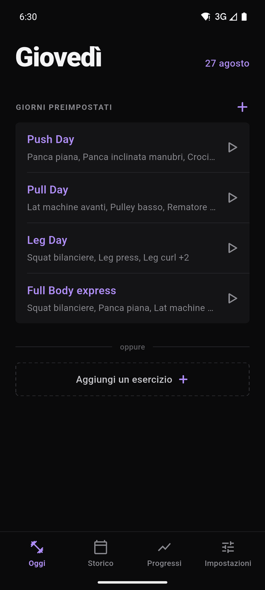
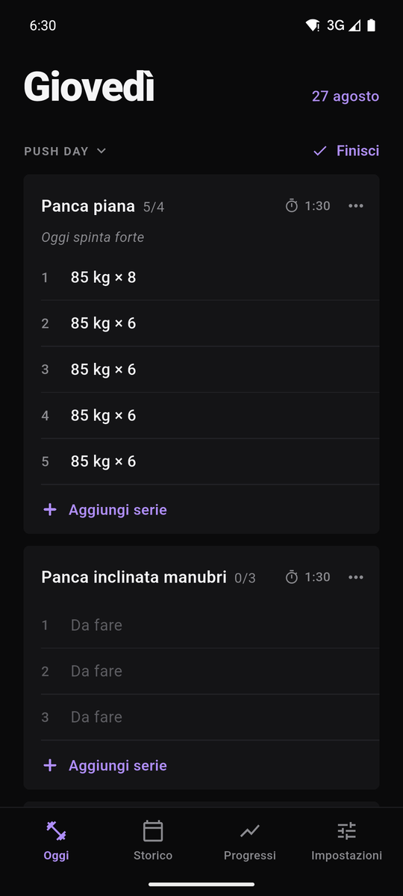
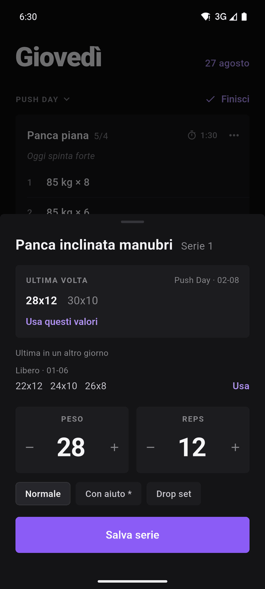
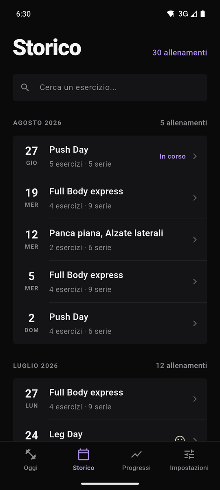
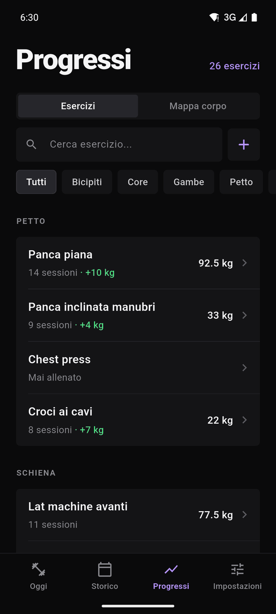
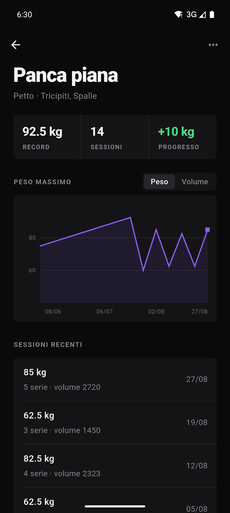
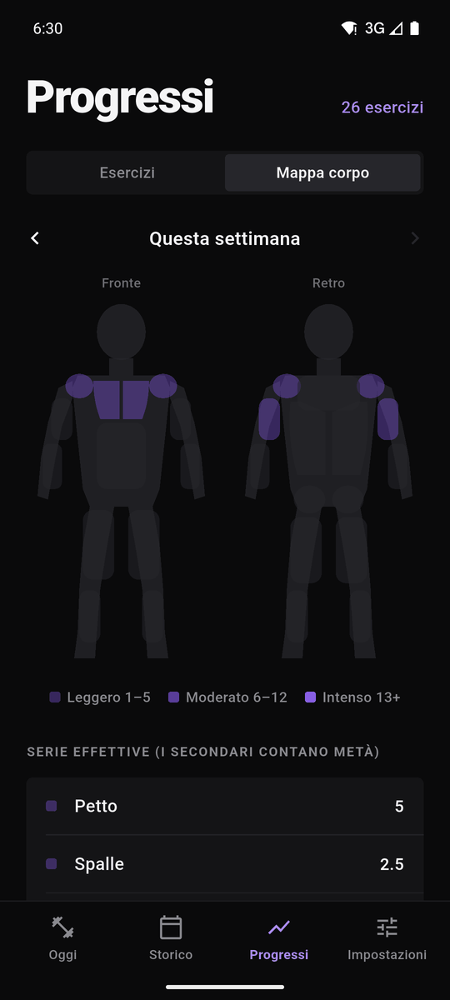
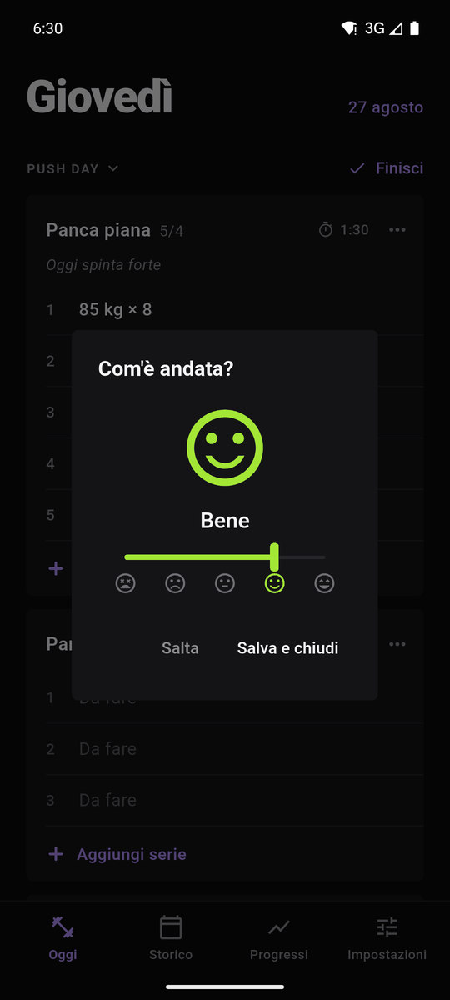
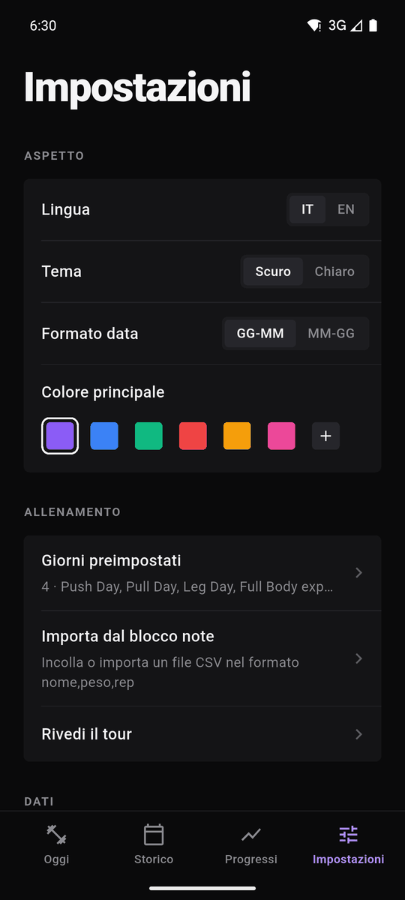

# GymTracker

Un diario di allenamento per Android, fatto su misura per come mi alleno io.
Segni esercizi e serie mentre sei in palestra, rivedi lo storico e guardi i
progressi. Tutto resta sul telefono: niente account, niente server, niente
pubblicità.

<p align="center">
  
  
  
  
</p>

## Da dove viene

GymTracker è un progetto personale. Ho iniziato a scriverlo a febbraio 2026
per segnare i miei allenamenti in palestra: il primo commit di questo
repository è del **23 febbraio 2026**. Da allora l'ho usato e modificato in
base a quello che mi serviva davvero, togliendo il resto.

A luglio 2026 è uscito [openGym](https://github.com/DuarteSantos8/openGym) di
Duarte Santos (primo commit il 18 luglio 2026), un tracker open source molto
conosciuto. L'idea di fondo è quasi la stessa: un'app gratuita, nata come
progetto personale, dove i dati restano tuoi. Le due app però sono nate in
modo indipendente, e GymTracker c'era già da cinque mesi.

### GymTracker e openGym

Le due app si somigliano molto. openGym fa molte più cose; GymTracker ne fa
meno, ma sono quelle che uso davvero. Se cerchi un'app completa, openGym è
probabilmente la scelta giusta.

openGym ha, tra le altre cose (dal [suo sito](https://opengym.ch/)):

- versione web da installare sul proprio server, con sincronizzazione fra
  dispositivi e accesso con passkey;
- un coach AI opzionale, con la propria chiave API;
- una libreria di migliaia di esercizi con animazioni;
- regole di progressione automatica, superset, cardio, serie di
  riscaldamento, RIR/RPE, stima del massimale e calcolo dei dischi;
- peso corporeo con grafico, mappa annuale delle sessioni, importazione da
  Strong, Hevy e FitNotes, 19 lingue.

Io queste funzioni non le uso. GymTracker invece è pensato così:

- **solo Android, solo sul telefono**: nessun server da gestire;
- **leggero**: l'APK pesa circa 50 MB (quella base di openGym 315 MB);
- **pochi tocchi per serie**: peso e ripetizioni sono già compilati con
  quelli dell'ultima volta, cambi solo ciò che serve;
- **il confronto giusto**: "l'ultima volta" è quella dello **stesso giorno
  della scheda**. La panca a fine allenamento in "Upper" non si confronta con
  la panca a inizio "Petto", dove sei più fresco.

## Funzioni

### Oggi
- **Giorni preimpostati** (le tue schede): un tocco su ▷ e carichi tutti gli
  esercizi del giorno, con serie previste e tempo di recupero. Tieni premuto
  un giorno per modificarlo.
- **Allenamento libero**: aggiungi gli esercizi uno alla volta.
- Ogni esercizio è un blocco con le serie fatte, quelle ancora **da fare**, il
  recupero e una **nota** (quella dell'ultima volta resta come promemoria).
- **Registrare una serie**: peso e ripetizioni già compilati dall'ultima
  volta nello stesso giorno, più l'ultima volta in un giorno diverso per
  confronto. Tre tipi di serie: normale, **con aiuto** e **drop set**.
- Tocchi una serie per correggerla, la scorri a sinistra per eliminarla
  (con "Annulla").
- **Finisci allenamento**: dici com'è andata con una faccina da 1 a 5,
  l'allenamento va nello Storico e Oggi riparte da zero. Se finisci dopo
  mezzanotte l'allenamento non si spezza in due.

### Storico
- Allenamenti raggruppati per mese, con giorno, esercizi, serie e la faccina
  colorata del voto.
- Ricerca per esercizio.
- Ogni sessione si apre e si modifica come quella di oggi: data, giorno,
  voto, esercizi e serie.

### Progressi
- La libreria degli esercizi, divisa per categoria, con muscoli primari e
  secondari.
- Per ogni esercizio: massimo, numero di sessioni, progresso, grafico del
  peso massimo e del volume, ultime sessioni.
- **Mappa del corpo**: quanto hai allenato ogni muscolo nella settimana, in
  serie effettive (i muscoli secondari contano metà).

<p align="center">
  
  
  
  
</p>

### Impostazioni
- Italiano o inglese, tema scuro o chiaro, formato della data.
- Colore principale: sei preimpostati o uno a scelta.
- **Importa dal blocco note**: chi segnava gli allenamenti nelle note può
  incollarli (una riga per esercizio: `panca piana,80,8,80,6*`).
- **Giorni preimpostati da testo**: si incolla una scheda nel formato
  `# Push Day` / `- Panca piana | 4x | 2:00`. L'app fornisce anche il testo
  da dare a un'AI per farsi scrivere la scheda già in questo formato.
- Un breve tour al primo avvio, che si può rivedere.

<p align="center">
  
</p>

## I dati

- Tutto è salvato sul telefono, in
  `Android/data/com.example.gymtracker2/files/gymTracker/`: file JSON leggibili
  e una copia in CSV di storico ed esercizi.
- **Backup automatico** ogni volta che finisci un allenamento (tiene gli
  ultimi 30) e **esportazione** del backup verso Drive, WhatsApp o altro.
- L'app non chiede il permesso di accedere a internet: i dati non escono dal
  telefono, a meno che non li esporti tu.

## Scaricare l'app

L'APK per Android è nella pagina
[Releases](https://github.com/s4nZo17/gymtracker/releases/latest): scaricalo
dal telefono e aprilo. Android chiede di consentire l'installazione da quella
fonte la prima volta.

## Compilare l'app

Serve [Flutter](https://docs.flutter.dev/get-started/install) (sviluppata con
la 3.35) e l'SDK Android.

```sh
git clone https://github.com/s4nZo17/gymtracker.git
cd gymtracker
flutter pub get
flutter build apk --release
# APK in build/app/outputs/flutter-apk/app-release.apk
```

I test della logica (contesto del giorno, fine allenamento, importazioni):

```sh
flutter test
```

## Stato del progetto

È l'app che uso io, quindi cresce secondo le mie esigenze. Segnalazioni di
bug e idee sono benvenute, ma non è detto che diventino funzioni.

## Licenza

Copyright (C) 2026 s4nZo17

GymTracker è software libero: puoi ridistribuirlo e modificarlo secondo i
termini della [GNU Affero General Public License](LICENSE), versione 3. In
breve: puoi usare, studiare e modificare il codice, ma se distribuisci una
versione modificata (anche come servizio in rete) devi pubblicarne il codice
con la stessa licenza.
