# GymTracker 2.0 — Documento di design

> **Ottobre 2026 — redesign minimal.** La sezione 0 qui sotto descrive l'app
> com'è adesso (screenshot in `img-minimal/`). Le sezioni 1–11 restano come
> fotografia della versione precedente (agosto 2026, screenshot in `img/`).

---

## 0. Redesign minimal

### 0.1 Le regole

1. **Monocromo.** L'accento colora solo l'azione principale della schermata
   (FAB "+ Esercizio", "+ Aggiungi serie", bottone di salvataggio) e i dati da
   evidenziare (ultimo punto del grafico, intensità sulla mappa del corpo).
   Tutto il resto è testo bianco/grigio su fondo neutro.
2. **Niente card in lista.** Le liste sono righe piatte (`ListRow`) separate
   da una linea sottile rientrata come il testo. Restano pochi blocchi tenui,
   senza bordo, solo dove serve raggruppare (riquadro "ultima volta").
3. **Gerarchia col testo.** Titolo di pagina 30/w700, titolo di blocco 17/w600,
   riga 15/w500, contorno 13 in grigio. Le etichette di sezione sono in
   minuscolo normale, non più in maiuscolo spaziato.
4. **Badge → testo.** Recupero, voto, giorno preimpostato, muscoli, tipo di
   serie: tutto testo, niente pillole colorate. Gli unici colori semantici
   rimasti sono arancio (con aiuto), blu (drop), verde/rosso (progresso).
5. **Cifre tabellari** (`kTabular`) su pesi, reps e date: le colonne restano
   allineate.
6. **Azioni scritte.** Le azioni rare di un esercizio (nota, recupero,
   progressi, rinomina, elimina) stanno in un menu a foglio con le voci
   scritte (`showActionSheet`), non in file di icone minuscole.
7. **Agire subito, annullare dopo.** Eliminare serie, esercizi e allenamenti
   non chiede conferma: si fa e si può annullare dalla snackbar (ora
   invertita: chiara sul fondo scuro e viceversa).

Token in `lib/theme.dart`: `kBg`, `kSurface`, `kSurface2`, `kSurface3`, `kLine`,
`kText/2/3`, raggi 14/10/22, stili di testo nella classe `T`.

### 0.2 Flussi sistemati

| Prima | Ora |
|---|---|
| **Esercizi** e **Progressi**: due schede con la stessa lista (nome + peso massimo) verso lo stesso grafico | Una scheda **Progressi** con toggle *Esercizi / Mappa corpo*. Tocchi un esercizio → la sua scheda: grafici, sessioni recenti e, nel menu, modifica / rimuovi dalla libreria. 4 tab invece di 5 |
| Oggi e Storico con due implementazioni diverse dello stesso esercizio (card con 4 bottoni / riga con 5 icone), due selettori esercizi, due editor di note | Un solo `ExerciseBlock`, un solo `ExercisePickerScreen` (con `session` opzionale), un solo `showNoteEditor` |
| Storico: card che si espandeva sul posto, piena di bottoni | Elenco piatto (data, giorno, quanto hai fatto) → tocchi e apri la sessione (`SessionScreen`), che si modifica come Oggi. Nuovo: eliminare un allenamento intero, con annulla |
| Giorni preimpostati applicabili da 4 punti; in Impostazioni "Applica" caricava gli esercizi ma ti lasciava lì | Si applicano solo da Oggi (lista nella giornata vuota, o "Carica un giorno preimpostato" in fondo). La pagina in Impostazioni serve solo a gestirli |
| Eliminare un esercizio: conferma **e** annulla | Solo annulla |
| "Nuovo giorno" sempre in evidenza, anche a sessione vuota | "Finisci" (in alto) e "Finisci allenamento" (in fondo), solo se c'è qualcosa da chiudere; il voto si chiede lì |
| Sessione rimasta aperta da giorni prima, intestata col giorno vecchio senza spiegazioni | Avviso "Questo allenamento è di un altro giorno · Inizia oggi". Una sessione vuota prende la data di oggi appena la riempi |
| Import: due tab con lo stesso modulo, testi fissi in italiano, "Vai allo storico" che non ci andava | Un modulo solo (il file riempie il campo di testo), tradotto, e a fine import si apre davvero lo Storico |
| Editor esercizio con due elenchi di muscoli identici (primari / secondari) | Un elenco: un tocco primario (pieno), due secondario (bordo), tre nessuno |
| Errore "inserisci peso e reps" in una snackbar finita dietro lo sheet | Errore scritto dentro lo sheet |
| Mappa del corpo a semaforo (verde/giallo/rosso) | Accento a tre intensità; muscoli in elenco ordinati dal più allenato |

### 0.3 Schermate

| Oggi | Sheet serie | Menu esercizio | Aggiungi esercizio |
|---|---|---|---|
| 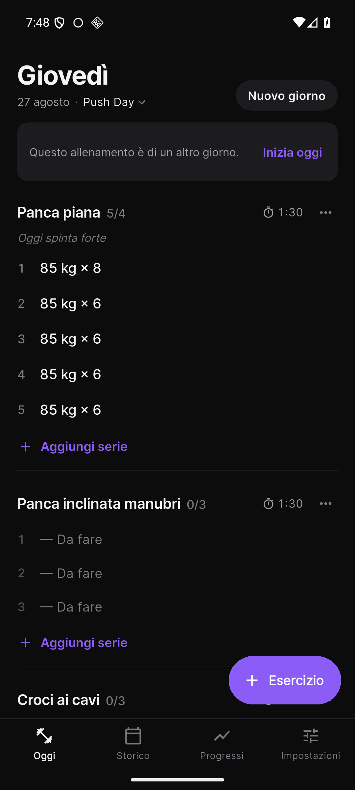 | 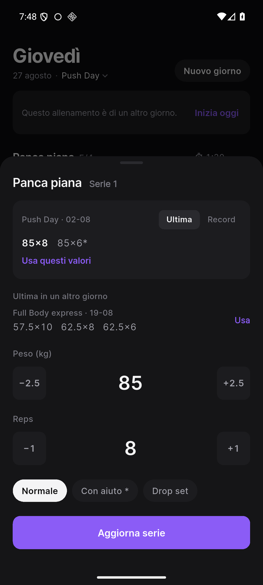 | 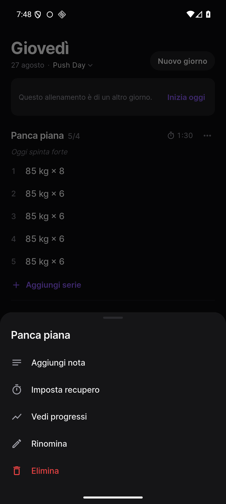 | 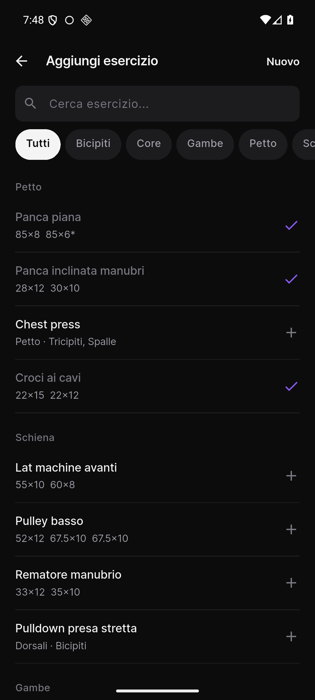 |

| Storico | Sessione | Progressi | Scheda esercizio |
|---|---|---|---|
| 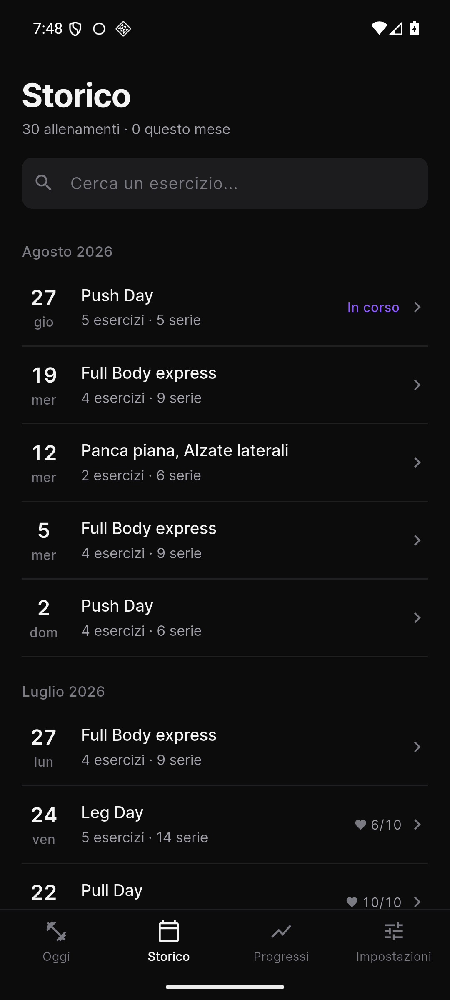 | 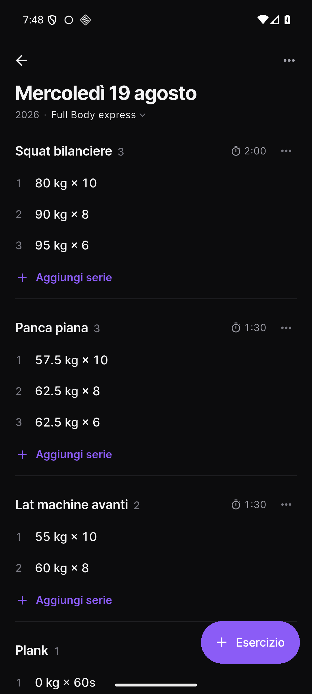 | 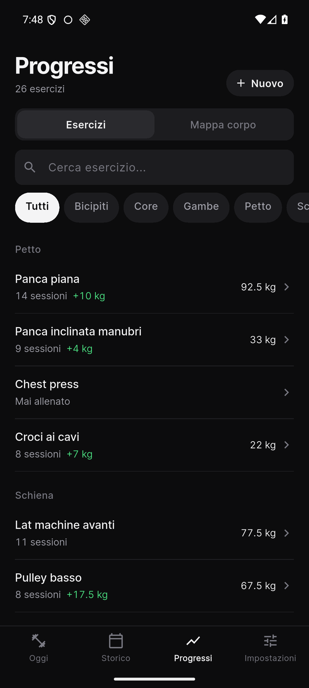 | 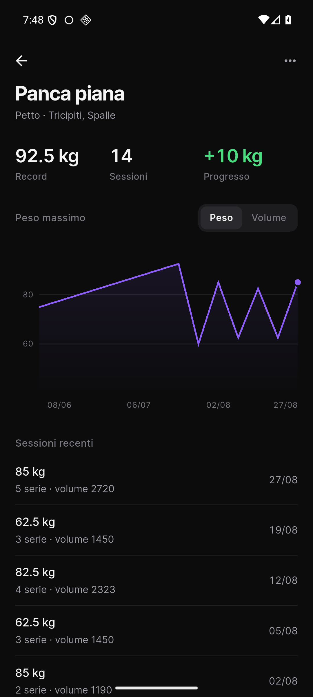 |

| Mappa corpo | Impostazioni | Giorni preimpostati | Oggi, giornata nuova |
|---|---|---|---|
| 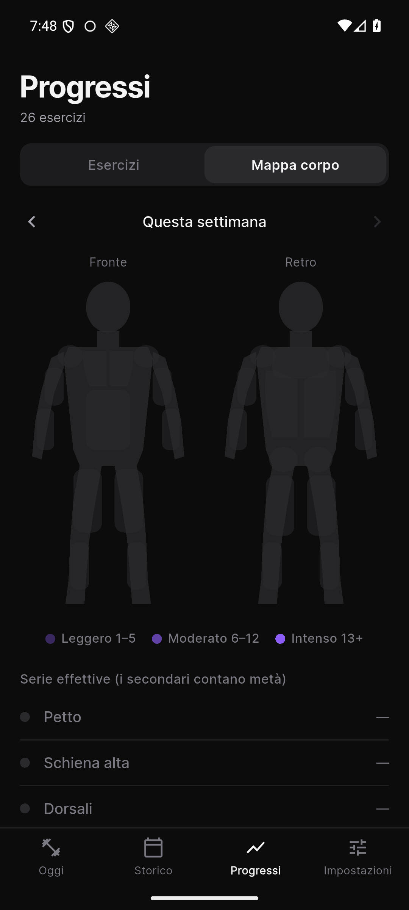 | 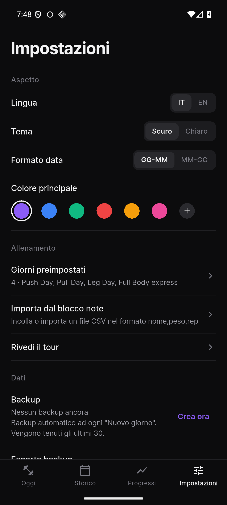 | 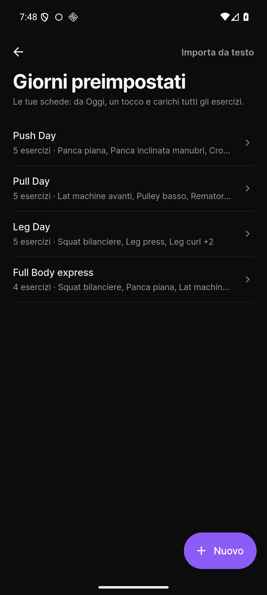 | 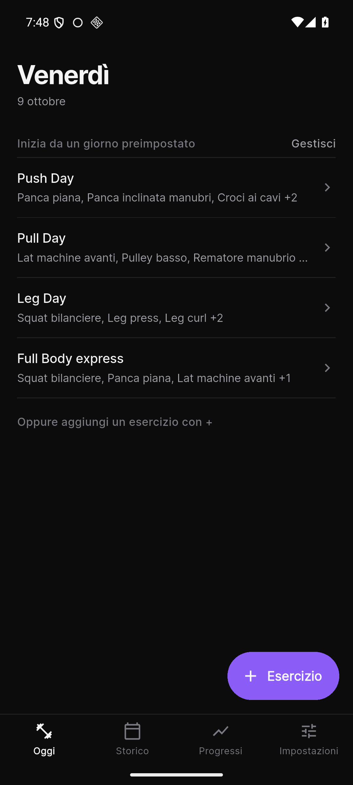 |

---

Ricognizione completa dell'interfaccia, schermata per schermata, con screenshot presi
dall'app in esecuzione (emulatore Android `core36`, 1080×2400, densità 420dpi, build debug
del 4 agosto 2026, **dopo il restyling di UI e navigazione**). I dati mostrati sono un set
di prova: 25 allenamenti su ~9 settimane, 4 schede preimpostate, libreria di 26 esercizi.

Tutti gli screenshot sono nella cartella `img/`.

### 0.4 Revisione 2 (stesso giorno)

Niente più forme tonde, peso e reps affiancati con "−/+" piccoli e passo 1,
il tasto "Finisci allenamento", un voto da 1 a 5 con le faccine, e il cambio
di giorno preimpostato che chiude l'allenamento in corso (Salva / Non salvare
/ Continua) invece di accodare gli esercizi. Dettagli e decisioni in
[GUIDA-OPERATIVA.md](GUIDA-OPERATIVA.md).

| Oggi | Serie | Com'è andata | Cambio giorno |
|---|---|---|---|
| 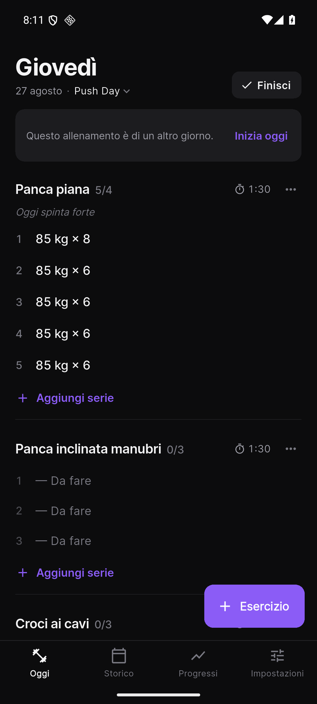 | 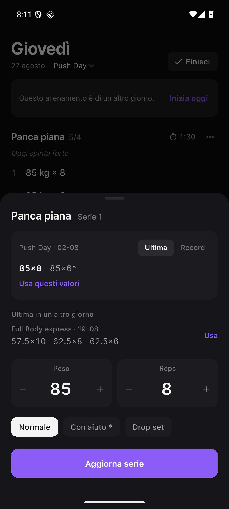 | 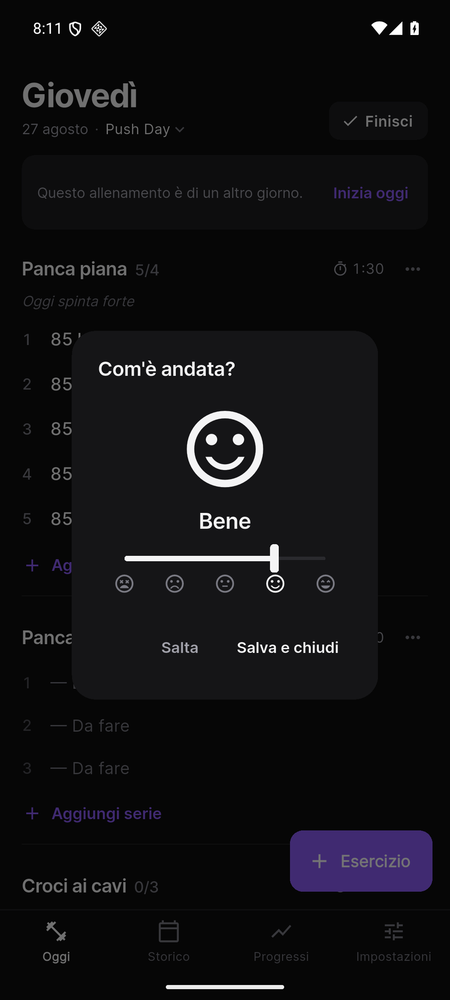 | 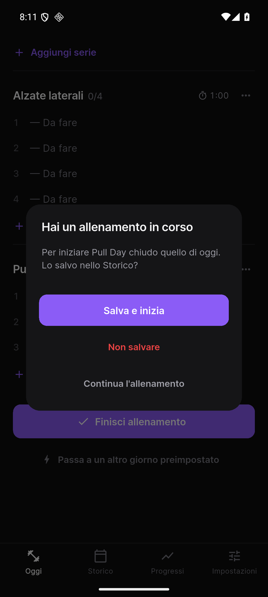 |

| Dopo il cambio | Storico | Impostazioni | Serie, tema chiaro |
|---|---|---|---|
| 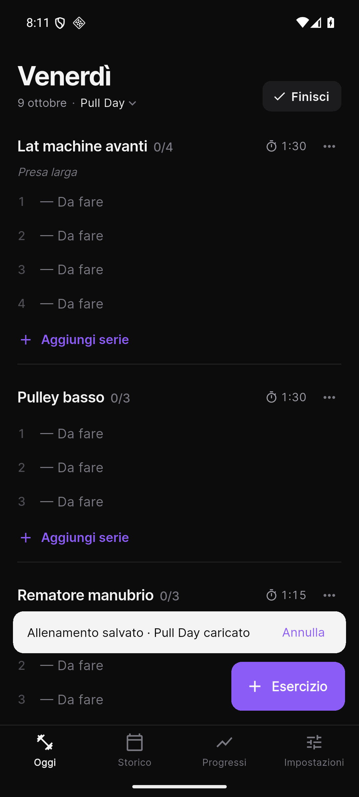 | 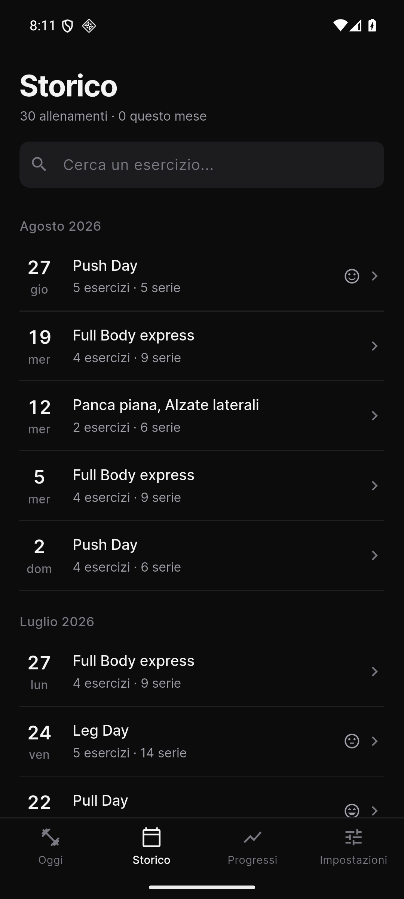 | 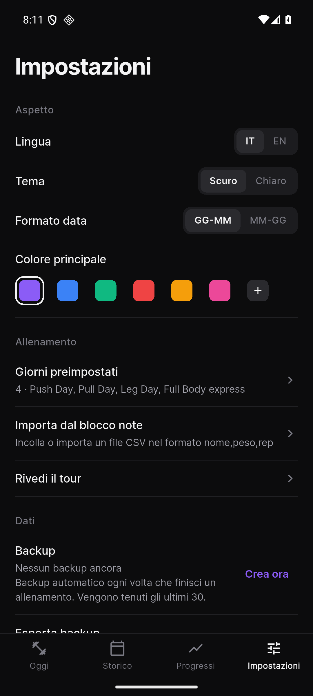 | 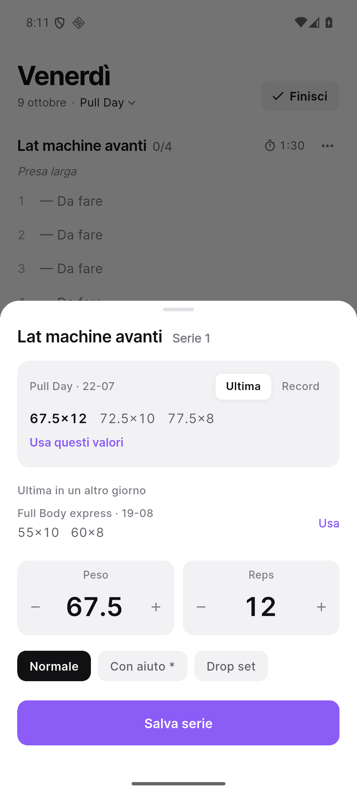 |

---

## 1. Il sistema di design

Tutto il look dell'app nasce da `lib/theme.dart`. Non ci sono colori sparsi nelle
schermate: le variabili globali (`kAccent`, `kBg`, `kSurface`…) vengono riscritte da
`AppTheme.apply()` ogni volta che cambi tema o accento, e ogni widget le legge.

### 1.1 Colori

**Accento** — 6 preset + colore libero:

| Preset | Nome | Primario | Secondario |
|---|---|---|---|
| `obsidian` | Obsidian (default) | `#8B5CF6` viola | `#6366F1` |
| `ocean` | Oceano | `#3B82F6` blu | `#06B6D4` |
| `emerald` | Smeraldo | `#10B981` verde | `#34D399` |
| `crimson` | Cremisi | `#EF4444` rosso | `#F97316` |
| `amber` | Ambra | `#F59E0B` ambra | `#FBBF24` |
| `rose` | Rosa | `#EC4899` rosa | `#F472B6` |
| `custom` | libero | scelto da te | derivato: +24° di tinta, −8% saturazione, +10% luminosità |

**Superfici e testo:**

| Ruolo | Tema scuro | Tema chiaro |
|---|---|---|
| Sfondo (`kBg`) | `#0A0A0C` | `#F6F6F9` |
| Superficie card (`kSurface`) | `#131316` | `#FFFFFF` |
| Superficie 2 — input, righe serie (`kSurface2`) | `#1B1B1F` | `#EFEFF4` |
| Superficie 3 — bordi, divisori (`kSurface3`) | `#2A2A30` | `#D8D8DE` |
| Testo primario (`kText`) | `#F5F5F7` | `#17171B` |
| Testo secondario (`kText2`) | `#A6A6B0` | `#54545E` |
| Testo terziario (`kText3`) | `#5B5B66` | `#9E9EA8` |

**Colori semantici** (fissi, non cambiano con l'accento): rosso `#EF4444` (azioni
distruttive), verde `#4ADE80` (miglioramenti, stimolo leggero), ambra `#FB923C`
(serie "con aiuto", stimolo moderato, record), blu `#60A5FA` (drop set).

### 1.2 Tipografia

Font unico: **Inter** (via `google_fonts`), usato per tutta l'app.

| Stile | Uso | Dimensione / peso |
|---|---|---|
| `displayLarge` | titoli grossi | 28 / w600, tracking −0.4 |
| `displayMedium` | titolo di pagina ("Domenica", "Storico") | 24 / w600, tracking −0.3 |
| `displaySmall` | titoli sezione | 20 / w600, tracking −0.2 |
| AppBar | titolo delle schermate di secondo livello | 19 / w600 |
| Corpo | testo normale | 14–16 |
| Etichette | tag, badge, label maiuscole | 10–12.5, spesso `letterSpacing` positivo |

Le label di sezione ("PETTO", "SESSIONI RECENTI", "PESO (KG)") sono in maiuscolo,
piccole, in `kText3`, con spaziatura tra le lettere: sono l'unico elemento "tipografico
decorativo" dell'app.

### 1.3 Forme e spaziature

- Raggi standardizzati in `theme.dart`: **card 18** (`kRadiusCard`), **controlli 12**
  (`kRadiusControl`), **bottom sheet 28** (`kRadiusSheet`), **pillole** (`kRadiusPill`).
  In pratica trovi anche 14–16 per bottoni e chip, 20–22 per dialog e fumetti del tour.
- Padding di pagina: **20px** sui lati.
- Bottoni principali: altezza minima **54px**, larghezza piena, raggio 16, senza ombra
  (`elevation: 0` ovunque — la profondità è data dal contrasto tra superfici, non dalle ombre).
- Card: fondo `kSurface`, bordo sottile `kSurface3` al 60% di opacità, nessuna ombra.
- La barra di navigazione è alta **62px**, con l'icona attiva dentro una "pillola"
  colorata di accento al 14%.

### 1.4 Componenti riutilizzabili (`lib/widgets/widgets.dart`)

Il restyling ha spostato in `widgets.dart` tutto quello che prima ogni schermata si
costruiva da sé. Oggi le cinque schede sono composizioni degli stessi pezzi:

| Componente | A cosa serve |
|---|---|
| `PageHeader` | l'intestazione identica delle 5 schede: titolo, sottotitolo, azione a destra, riga opzionale sotto (ricerca o toggle) |
| `AppSearchField` | il campo di ricerca di Esercizi, Storico e Progressi |
| `SegmentedToggle` | tutte le scelte binarie/ternarie a pillola (Grafici/Mappa corpo, Peso/Volume, IT/EN, Scuro/Chiaro, Incolla testo/Da file…) |
| `SeriesRow` | la riga di una serie, con swipe per eliminare |
| `showAppSnack` | l'unico modo di dare feedback, con "Annulla" opzionale |
| `LastSessionCard` | il riquadro "sessione precedente / record" dentro lo sheet serie |
| `showAppSheet`, `SheetTitle`, `confirmDialog` | sheet e dialog standard |
| `AppCard`, `SectionTitle`, `EmptyState`, `StatCard` | i mattoni delle liste e delle pagine di dettaglio |
| `SeriesBadge`, `SeriesNumBadge`, `DropsDisplay`, `RestBadge`, `RestPickerDialog`, `CategoryChip`, `MuscleTag`, `RatingBadge` | i pezzi piccoli ricorrenti |

---

## 2. Primo avvio

### 2.1 Setup wizard (3 passi)

Sfondo nero pieno, logo **GYMLOG** con icona manubrio in accento, testo del passo,
opzioni a card grandi, e in basso il bottone primario a destra + indicatore a puntini
(quello attivo diventa una barretta).

| Lingua | Formato data | Tema + accento |
|---|---|---|
| 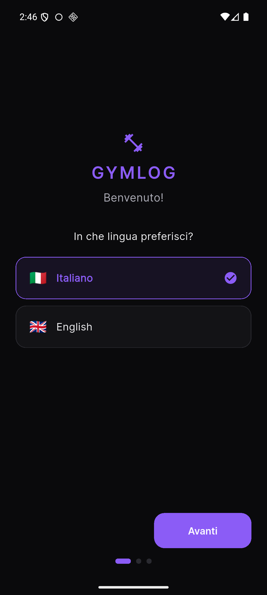 | 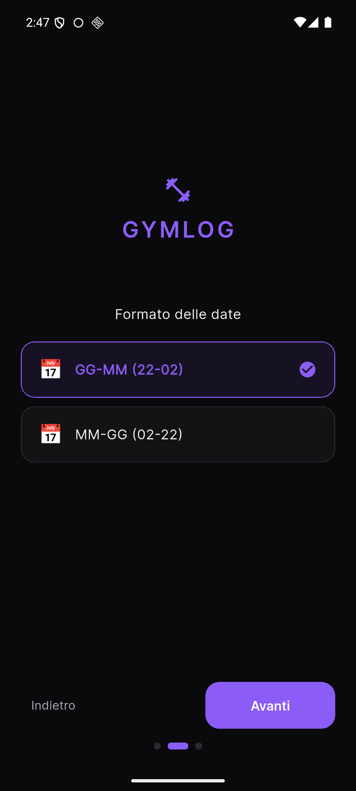 | 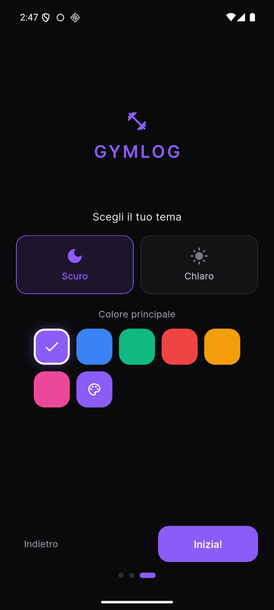 |

Le card selezionate si riconoscono da tre segnali insieme: bordo accento, fondo accento
al 10%, testo in accento + spunta a destra. Gli emoji bandiera/calendario fanno da icona.

Il selettore colore libero è un dialog dedicato con area saturazione/luminosità, slider
di tinta, anteprima circolare e campo HEX:

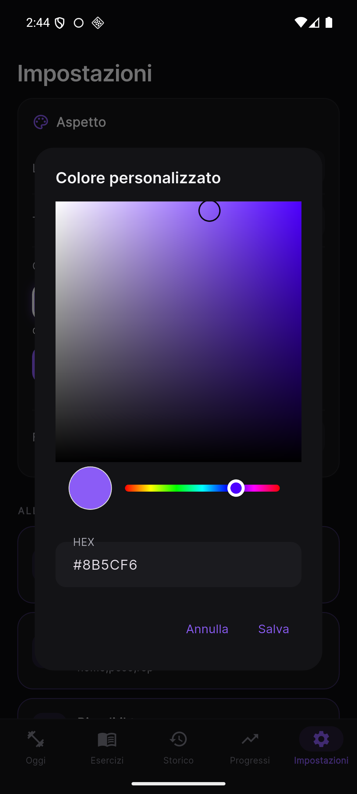

### 2.2 Tour interattivo (4 passi)

Dopo il setup parte un tour costruito in casa (`widgets/app_tour.dart`): un overlay nero
al 72% con un "buco" ritagliato sull'elemento spiegato, bordo luminoso in accento intorno
al buco, e un fumetto che si posiziona sopra o sotto a seconda di dove c'è più spazio.
Il fumetto ha il contatore `1/4` in un badge accento, titolo, testo e i bottoni Salta / Avanti.

| 1 — Aggiungi esercizi | 2 — Giorni preimpostati | 3 — Nuovo giorno | 4 — Tutto il resto |
|---|---|---|---|
| 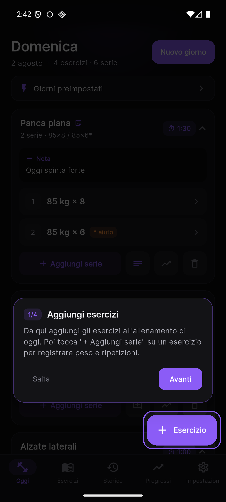 | 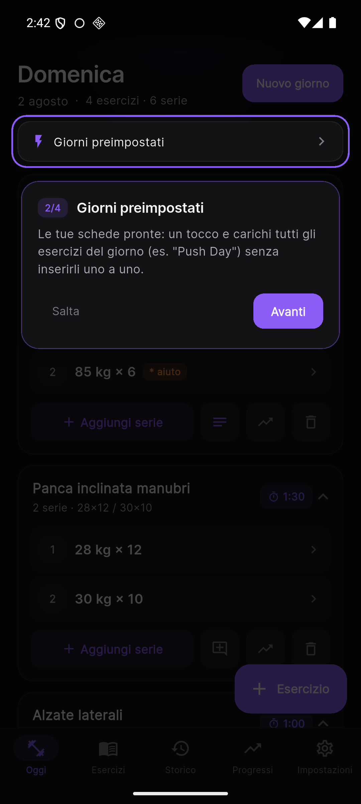 | 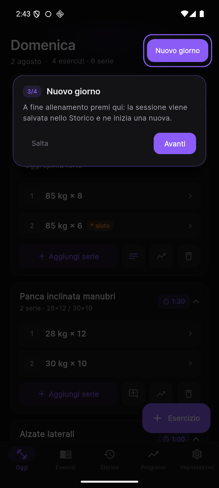 | 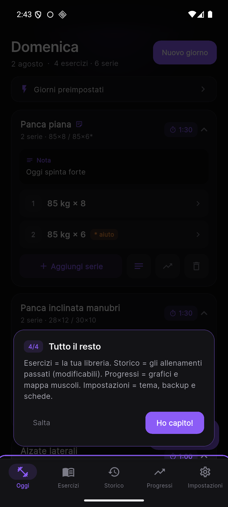 |

Si può rilanciare da Impostazioni → "Rivedi il tour".

---

## 3. Struttura dell'app

Dopo il setup c'è una sola shell (`MainShell`) con **5 tab** in un `IndexedStack`
(le schermate restano vive, non si ricostruiscono quando cambi tab):

**Oggi · Esercizi · Storico · Progressi · Impostazioni**

Icona outline quando è spenta, icona piena + pillola accento + label in accento quando è
attiva.

Ogni scheda è avvolta nel proprio `ScaffoldMessenger`: le snackbar appartengono alla
scheda che le ha generate e il pulsante flottante si sposta in su per lasciarle spazio,
invece di finirci sotto.

Tutte e cinque le schede si aprono con lo stesso `PageHeader` — titolo grande, sottotitolo
di contesto ("26 esercizi", "25 allenamenti · Questo mese: 1"), eventuale azione a destra
e, subito sotto, ricerca o toggle. Le vecchie AppBar disomogenee non ci sono più: le
AppBar sopravvivono solo nelle schermate di secondo livello (grafico esercizio, editor
scheda, importa), dove servono per la freccia "indietro".

---

## 4. Oggi

La schermata di lavoro. In alto un alone radiale dell'accento al 10% che sfuma verso il
nero: è l'unico effetto "atmosferico" dell'app.

**Header:** giorno della settimana in grande, sotto la data + riepilogo "4 esercizi · 6 serie"
(+ badge voto se la sessione è già stata valutata), e a destra il bottone **Nuovo giorno**.
Subito sotto, la riga **Giorni preimpostati** per caricare una scheda intera.

| Vuoto | Con allenamento | Scorrendo |
|---|---|---|
| 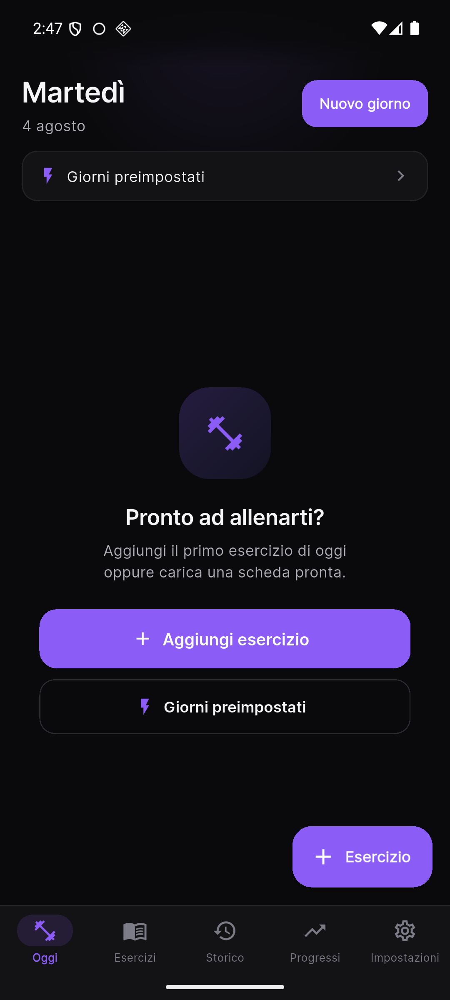 | 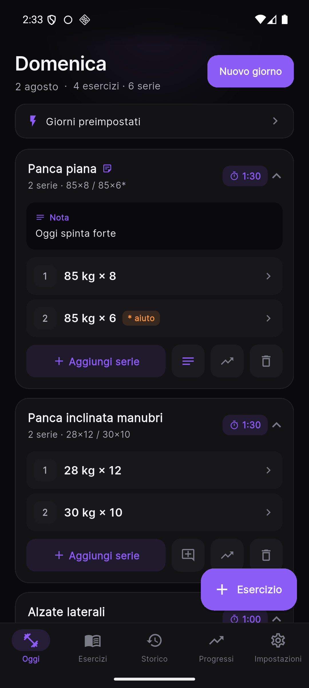 | 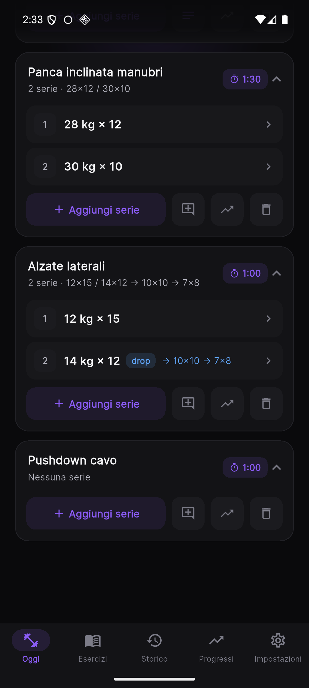 |

Lo stato vuoto non è solo un'icona: propone le due azioni possibili ("Aggiungi esercizio"
primario, "Giorni preimpostati" secondario).

**Card esercizio:** nome + icona nota se presente, sottotitolo con il riassunto delle serie
(`2 serie · 85×8 / 85×6*`), badge del recupero (`⏱ 1:30`) e freccia per collassare. Poi la
nota (se c'è) in un riquadro dedicato, e **una riga per serie** (`SeriesRow`): numero in un
quadratino, `85 kg × 8` in grande, eventuale badge del tipo, chevron a destra. La riga
intera è toccabile per modificare, e si **scorre verso sinistra per eliminarla**: parte
subito, con una snackbar "Serie eliminata · Annulla" invece di una conferma preventiva.
In fondo il bottone **+ Aggiungi serie** a piena larghezza, con accanto i bottoni nota,
progressi e cestino.

Codifica dei tipi di serie: nessun badge = normale; `* aiuto` in ambra = serie con aiuto;
`drop` in blu seguito dalla catena `→ 10×10 → 7×8` = drop set.

FAB esteso **+ Esercizio** in basso a destra.

### 4.1 Sheet "Aggiungi serie"

Il pezzo di UI più curato dell'app. Bottom sheet con:

- il riquadro di contesto in cima, con un toggle **Ultima / Record**: a sinistra la
  sessione precedente (in accento), a destra il record per serie (in ambra, con la coppa).
  Le serie sono chip che vanno a capo — la card si dimensiona sul contenuto, quindi non si
  taglia neanche con molte serie — e sotto c'è "Usa stessi valori →" / "Usa questi valori →";
- **PESO (KG)**: valore enorme al centro fra due bottoni `−2.5` / `+2.5`;
- **REPS**: stessa struttura con `−1` / `+1`;
- **TIPO SERIE**: tre pillole Normale / Con aiuto \* / Drop set;
- bottone **Salva serie** a piena larghezza.

Scegliendo *Drop set* compaiono le righe dei drop (badge `D1`, peso, reps, "×") e il
bottone **Aggiungi drop**, tutto in blu per coerenza con il badge nella lista.

| Serie normale | Drop set |
|---|---|
| 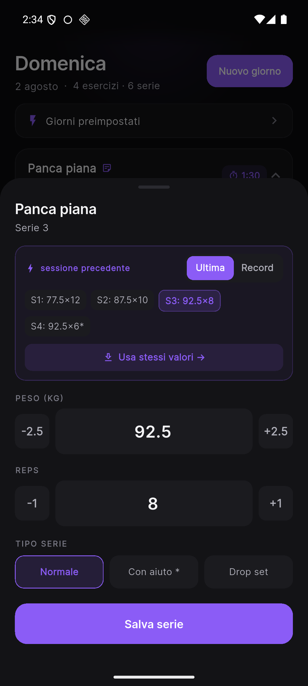 | 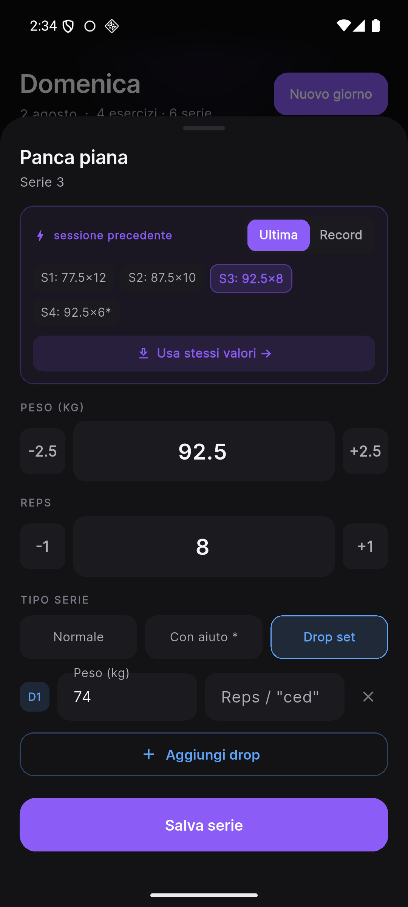 |

### 4.2 Dialog di Oggi

| Recupero | Nota esercizio | Voto sessione | Conferma eliminazione |
|---|---|---|---|
| 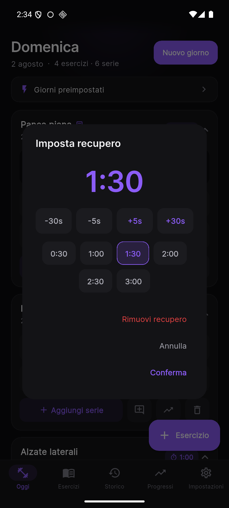 | 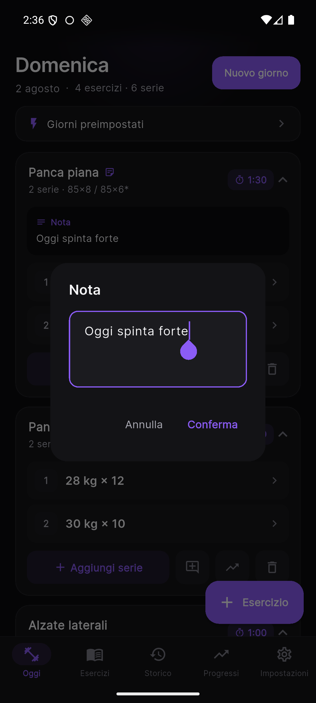 | 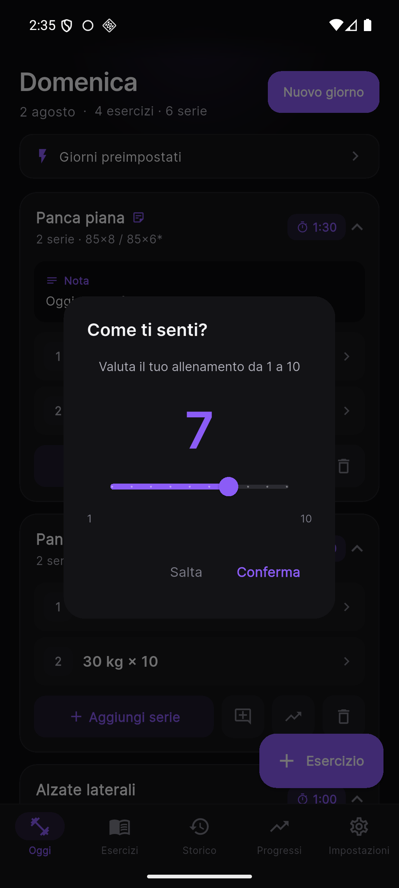 | 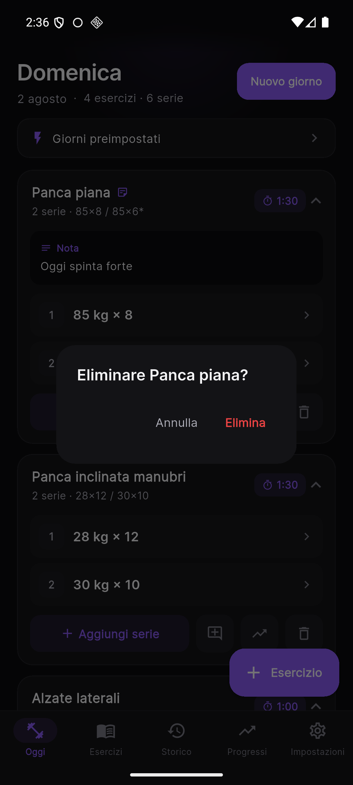 |

- **Imposta recupero**: tempo gigante in accento, ±30s/±5s, preset 0:30→3:00, e in rosso
  "Rimuovi recupero".
- **Nota**: dialog piccolo con campo multilinea bordato in accento.
- **Come ti senti?**: appare premendo "Nuovo giorno" se la sessione ha serie e non è ancora
  valutata — slider 1-10 con il numero grande in accento, e "Salta" sempre disponibile.
- **Conferme**: sempre lo stesso schema, titolo-domanda e due azioni testuali, quella
  distruttiva in rosso. Si usano solo dove non c'è un annullamento possibile.

### 4.3 Scelta esercizio e schede

| Giorni preimpostati (sheet) | Aggiungi esercizio | Nuovo esercizio |
|---|---|---|
| 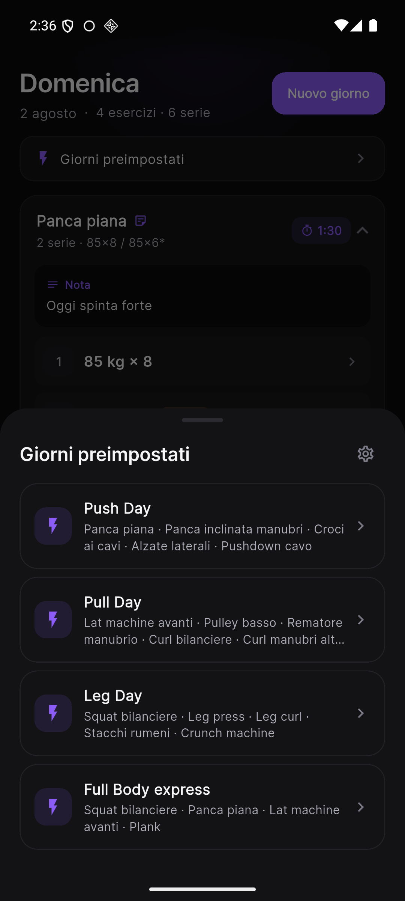 | 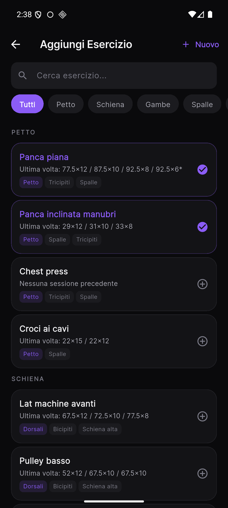 | 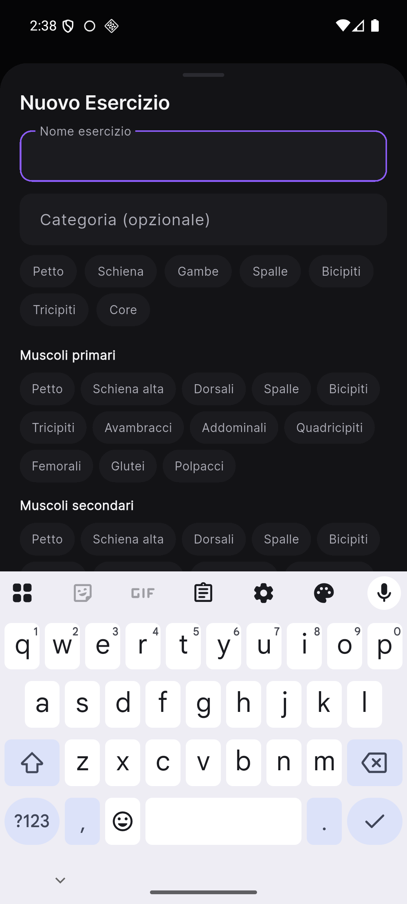 |

Nel picker ogni esercizio mostra **"Ultima volta: 77.5×12 / 87.5×10 / 92.5×8 / 92.5×6*"**
o "Nessuna sessione precedente", più i tag muscolari (primario in accento, secondari
grigi). Quelli già inseriti oggi hanno bordo accento, nome in accento e spunta piena al
posto del "+". In alto: ricerca e filtri per categoria a pillole.

La creazione di un nuovo esercizio chiede nome, categoria (a scelta libera o dalle pillole)
e i muscoli **primari** e **secondari** — è questa informazione che alimenta la mappa del corpo.

---

## 5. Esercizi (libreria)

Lista di tutti gli esercizi raggruppati per categoria — con il conteggio accanto al nome
della sezione (`PETTO · 4`) — ricerca e filtri a pillole in cima, FAB "+" per crearne di
nuovi. Ogni riga: nome, tag muscolari, il **peso massimo** in un badge accento e il menu
"…".

| Libreria | Menu di un esercizio |
|---|---|
| 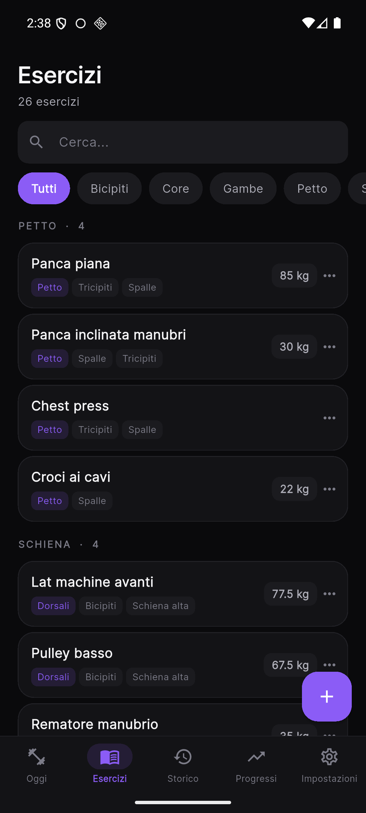 | 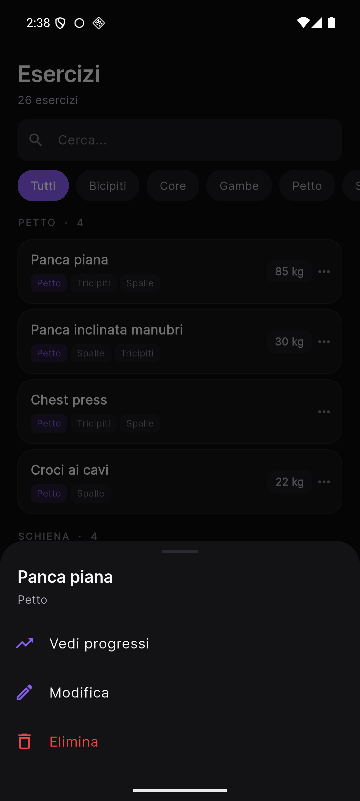 |

Il menu è uno sheet intitolato col nome dell'esercizio e la sua categoria, con tre voci:
**Vedi progressi** (porta direttamente al grafico, senza passare dalla scheda Progressi),
**Modifica**, **Elimina** in rosso.

L'app parte con 26 esercizi predefiniti già categorizzati (Petto, Schiena, Gambe, Spalle,
Bicipiti, Tricipiti, Core).

---

## 6. Storico

Un elenco di sessioni, una card per giorno, ordinate dalla più recente, raggruppate per
mese (`AGOSTO 2026`) e filtrabili con la ricerca per esercizio.

| Vuoto | Elenco | Sessione aperta | Modifica di una serie |
|---|---|---|---|
| 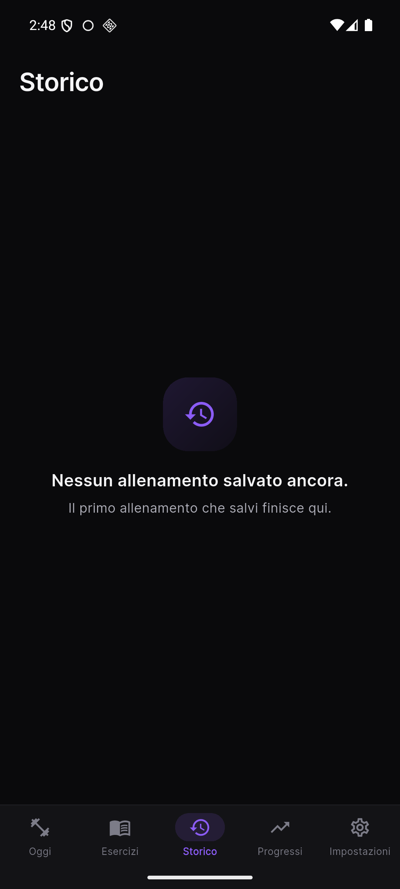 | 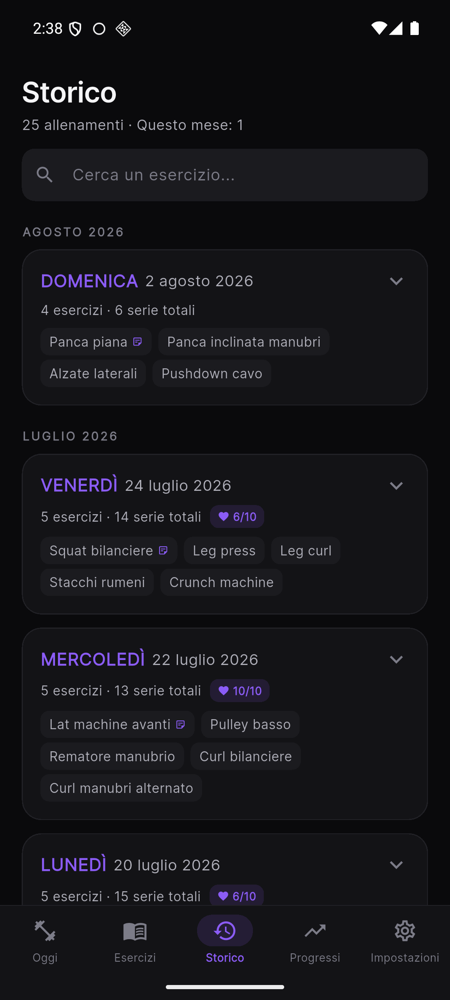 | 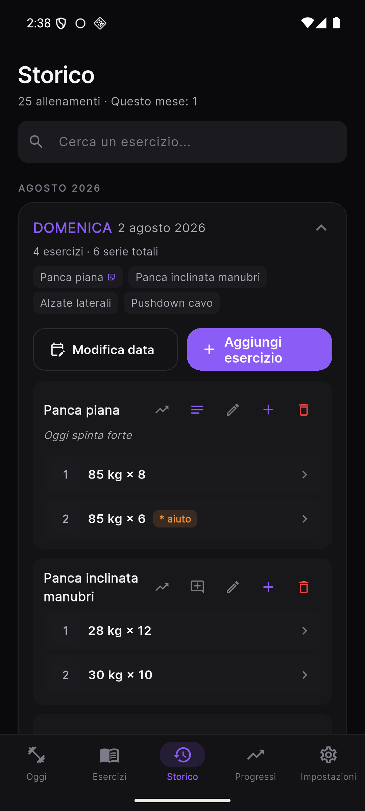 | 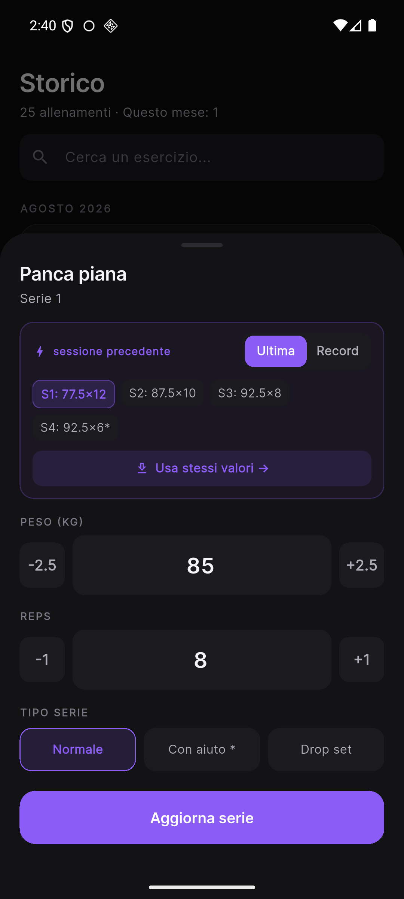 |

**Card chiusa:** giorno della settimana in MAIUSCOLO accento + data, riga "5 esercizi ·
14 serie totali", badge voto (`♥ 10/10`) e i nomi degli esercizi come chip (con
l'iconcina nota su quelli che ne hanno una).

**Card aperta:** compaiono "Modifica data" e "Aggiungi esercizio", poi ogni esercizio in
un blocco con le sue azioni in riga (progressi, nota, rinomina, aggiungi serie, elimina in
rosso) e l'elenco completo delle serie. Toccando una serie si apre lo stesso sheet di
Oggi, già compilato. Lo storico è quindi **completamente modificabile a posteriori**, non
è un archivio in sola lettura.

---

## 7. Progressi

Due sotto-schede in un `SegmentedToggle`: **Grafici** e **Mappa corpo**.

### 7.1 Grafici

| Vuoto | Elenco esercizi | Peso massimo | Volume |
|---|---|---|---|
| 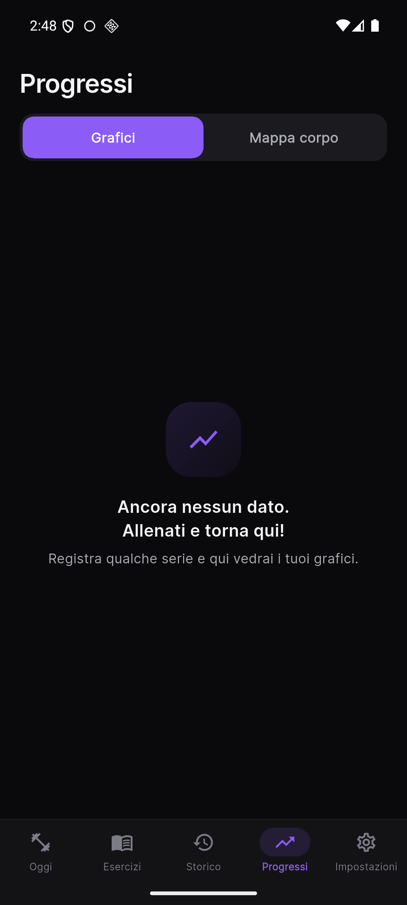 | 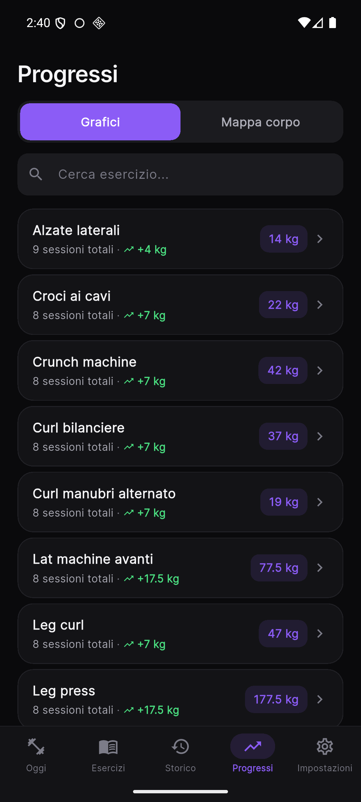 | 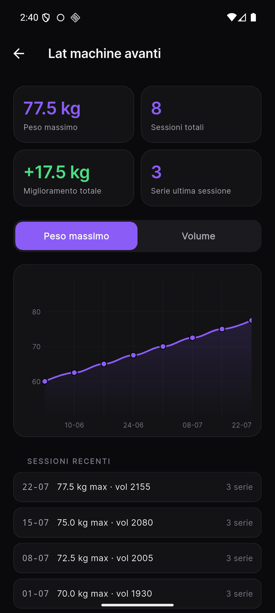 | 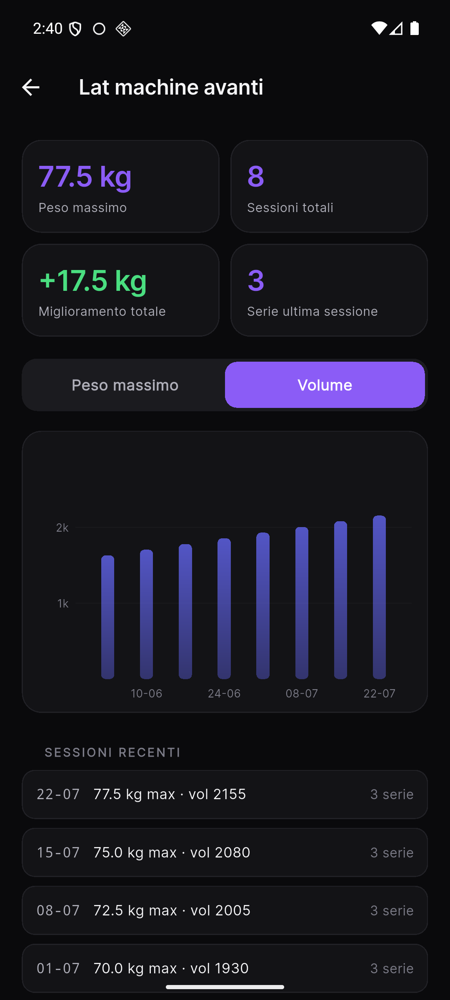 |

L'elenco mostra per ogni esercizio il numero di sessioni, il **miglioramento** in verde
(`↗ +17.5 kg`) e il record in un badge accento. Toccandolo si apre la scheda dell'esercizio con:

- quattro **StatCard** in griglia 2×2: peso massimo, sessioni totali, miglioramento totale
  (in verde quando è positivo), serie dell'ultima sessione;
- toggle **Peso massimo / Volume**;
- il grafico: linea curva con area sfumata sotto e pallini sui punti per il peso, barre con
  gradiente verticale per il volume; griglia sottile, etichette date in `dd-MM` contate
  all'indietro dall'ultima sessione, così l'ultima data c'è sempre ed è distanziata come le altre;
- lista **SESSIONI RECENTI**: `22-07 · 77.5 kg max · vol 2155 · 3 serie`.

### 7.2 Mappa corpo

Due sagome (FRONTE / RETRO) dentro una card, colorate in base alle **serie effettive** per
gruppo muscolare nella settimana selezionata (i muscoli secondari contano metà: da qui i
"4.5 serie effettive").

| Settimana in corso | Settimana piena | Legenda ed elenco |
|---|---|---|
|  |  |  |

Scala: grigio = non allenato, verde `#4ADE80` = leggero (1-5 serie), ambra `#FBBF24` =
moderato (6-12), rosso `#EF4444` = intenso (13+). Il corpo "spento" è volutamente poco
contrastato, così i muscoli allenati saltano all'occhio anche di sfuggita. Sopra c'è il
navigatore di settimana (`‹ Settimana del 27 lug - 2 ago ›`, freccia avanti disabilitata
sul futuro), sotto la legenda e l'elenco di tutti i 12 gruppi muscolari con il conteggio.

---

## 8. Impostazioni

| Aspetto | Backup e statistiche | Cartella dati e zona pericolo |
|---|---|---|
|  |  |  |

La pagina è divisa in tre gruppi con etichetta di sezione (ASPETTO nella prima card,
poi ALLENAMENTO e DATI):

1. **Aspetto** — una sola card con lingua IT/EN, tema Scuro/Chiaro, i 7 riquadri colore
   (quello attivo con bordo bianco e alone) e formato data GG-MM / MM-GG, separati da
   divisori sottili. Tutti i toggle sono `SegmentedToggle`: il segmento attivo è pieno di
   accento con testo bianco.
2. **Allenamento** — tre righe di navigazione: **Giorni preimpostati**, **Importa dal
   blocco note**, **Rivedi il tour** — bordo accento tenue, icona in un quadrato colorato,
   sottotitolo esplicativo, chevron.
3. **Dati** — **Backup** (automatico a ogni "Nuovo giorno", ne tiene 30, stato dell'ultimo
   backup, "Crea backup ora" e "Esporta / condividi…"), **Statistiche** (allenamenti
   totali, esercizi in libreria, serie totali), **Cartella dati** (percorso completo
   copiabile e spiegazione dei 4 file) e **Zona pericolo** ("Cancella tutti i dati" in
   rosso su fondo rosso tenue, isolato in fondo alla pagina).

In basso la versione: *GymTracker 2.0*.

### 8.1 Giorni preimpostati

| Elenco schede | Editor scheda |
|---|---|
|  |  |

Ogni scheda è una card con nome, matita e cestino, gli esercizi come chip con il proprio
recupero (`Panca piana ⏱ 1:30`) e un bottone **Applica** a piena larghezza.
L'editor ha nome, chip degli esercizi scelti (rimovibili con "×") e sotto la libreria
completa con selezione a spunta.

### 8.2 Importa dal blocco note

Card informativa in cima con il formato accettato (`nome esercizio,peso,rep,peso,rep,…`,
`*` = con aiuto, `peso-drop,rep-rep` = drop set) ed esempi, toggle **Incolla testo / Da
file**, selettore della data e area di testo monospaziata con placeholder di esempio.

---

## 9. Temi, accenti e lingua

Lo stesso schermo cambia completamente pelle senza cambiare struttura:

| Chiaro — Oggi | Chiaro — Impostazioni | Chiaro — Mappa corpo |
|---|---|---|
|  |  |  |

| Accento Smeraldo | Interfaccia in inglese |
|---|---|
|  |  |

Nel tema chiaro le card diventano bianche su sfondo `#F6F6F9` e i fondi "tenui" dei
bottoni secondari diventano accento molto diluito. L'accento tocca tutto: bottoni, badge,
icone attive, bordi selezionati, grafici, alone dell'header. Il cambio è immediato su
tutte le schede, inclusa la mappa del corpo. La traduzione è totale sull'UI (i nomi degli
esercizi e le note restano ovviamente come li hai scritti).

---

## 10. Regole che tengono insieme l'interfaccia

1. **Un solo accento per volta**, applicato ovunque; i colori semantici (rosso/verde/ambra/blu)
   non cambiano mai, così "distruttivo" e "aiuto" restano riconoscibili con qualunque tema.
2. **Niente ombre.** La gerarchia è fatta con 4 livelli di superficie e bordi sottili.
3. **Stessa testata ovunque.** Le cinque schede si aprono tutte con `PageHeader`: cambia il
   contenuto, non la struttura, e il titolo dice sempre anche "quanto" (26 esercizi, 25
   allenamenti).
4. **Bersagli grandi.** Righe serie, card e bottoni sono tutti toccabili per intero; le
   icone piccole esistono solo come azioni secondarie.
5. **Agire subito, annullare dopo.** Le azioni reversibili non chiedono conferma: si
   eseguono e lasciano una snackbar con "Annulla". I dialog di conferma restano solo per
   ciò che non si può disfare.
6. **Stati vuoti utili**: icona in un quadrato smussato, frase in `kText2`, e — dove ha
   senso — le azioni per uscire dallo stato vuoto.
7. **Contesto sempre visibile**: ultima sessione e record nello sheet, riepilogo serie nel
   titolo della card, così non serve navigare per ricordarsi cosa hai fatto la volta prima.
8. **Sheet per creare/modificare, dialog per decidere.** Le due cose non si mescolano mai.
9. **Numeri protagonisti**: peso, reps, tempo di recupero, voto e statistiche sono sempre
   il testo più grande del proprio blocco.

---

## 11. Cosa è cambiato con il restyling

Il documento fotografa l'app **dopo** l'intervento su UI e navigazione. In sintesi:

- **Testata unica** (`PageHeader`) e ricerca standard su Oggi, Esercizi, Storico,
  Progressi, Impostazioni, al posto di AppBar e intestazioni diverse su ogni scheda.
- **Toggle segmentato unico** per tutte le scelte a pillola, dove prima c'erano tab,
  bottoni e chip diversi.
- **Swipe per eliminare una serie** con annullamento, al posto della "×" su ogni riga.
- **Scorciatoie ai progressi** dalla card esercizio di Oggi, dal menu della libreria e
  dallo storico.
- **Sheet serie** riscritto: toggle Ultima/Record al posto dello swipe nascosto, card che
  si dimensiona sul contenuto.
- **Impostazioni raggruppate** in Aspetto / Allenamento / Dati.
- **Mappa corpo** con più contrasto tra corpo spento e muscoli allenati.

Difetti trovati durante la ricognizione e **risolti**:

- overflow di 11px nella card "ULTIMA VOLTA" dello sheet serie;
- la mappa del corpo restava col fondo del tema vecchio finché non si riavviava l'app;
- la snackbar "Annulla" finiva sotto al FAB "+ Esercizio": i due bersagli si sovrapponevano
  e, se la snackbar spariva un istante prima del tocco, si apriva il selettore esercizi;
- etichette delle date sovrapposte sul bordo destro dei grafici ("15-0722-07");
- nel drop set: "+" doppio sul bottone "Aggiungi drop" ed etichette dei campi troncate.
